# Morph Expressive

Morph Expressive is a Flutter design system inspired by Material 3 Expressive. It
builds on its ideas with a focus on symmetry, rounded shapes, balanced colors,
and smooth animations.

The goal is to make components look and feel consistent while exploring new
styles and interactions beyond Material 3 Expressive.

## Highlights

- **Expressive components:** buttons, chips, text fields, lists, menus, dialogs, sheets, indicators and more.
- **Frosted surfaces:** theme-aware glass for compatible floating surfaces and opt-in frosted cards.
- **Blur-safe scrolling:** Flutter-like geometric stretch with `MorphScrollBehavior`.
- **Navigation:** animated bars, rails and drawers, with floating, scroll-aware compositions.
- **Interaction and accessibility:** spring-based motion, haptic feedback and reduced-motion support.

## Requirements

- Flutter >= 3.47.0, Dart ^3.13.0.
- Uses the `material_ui` package for Material widgets.
- No specific routing or state-management package is required.

## Installation

```yaml
dependencies:
  morph_expressive: ^0.7.0
```

Run `flutter pub get` after updating the dependency. For local development,
you can use a Git/path dependency pointing at this checkout.

## Quick start

```dart
import 'package:material_ui/material_ui.dart'
    show Center, Color, MaterialApp, Scaffold, Text, runApp;
import 'package:morph_expressive/morph_expressive.dart'
    show MorphButton, MorphTheme, MorphThemeData;

void main() {
  const seed = Color(0xFF6750A4);
  final theme = MorphThemeData.light(seedColor: seed);

  runApp(
    MaterialApp(
      theme: theme.toThemeData(),
      home: MorphTheme(
        data: theme,
        child: Scaffold(
          body: Center(
            child: MorphButton(
              onPressed: () {},
              label: const Text('Continue'),
            ),
          ),
        ),
      ),
    ),
  );
}
```

This example uses a fixed light theme. For dynamic brightness, keep `MorphTheme`
and the host Material theme synchronized. `MaterialApp.router` is supported.

## Frosted surfaces and blur-safe scrolling

`MorphSurfaceGlass` enables theme-aware blur, tint and border for compatible
floating surfaces. Menus, dialogs, dropdown panels and sheets can inherit
`MorphThemeData.floatingSurfaceGlass` or override it locally. Cards remain
opaque by default; opt into frosted rendering with `MorphCard(frosted: true)`
or an explicit `glass:` configuration.

`MorphScrollBehavior` adds Flutter-like geometric stretch without an
`ImageFiltered` ancestor above frosted content.

```dart
final theme = MorphThemeData.light(
  seedColor: const Color(0xFF6750A4),
).copyWith(
  floatingSurfaceGlass: const MorphSurfaceGlass(
    blurX: 12,
    blurY: 12,
    tintOpacity: 0.65,
  ),
);

// Inside the MorphTheme subtree:
ScrollConfiguration(
  behavior: const MorphScrollBehavior(),
  child: ListView(
    children: const [
      MorphCard(headline: 'Opaque by default'),
      MorphCard(frosted: true, headline: 'Theme frosted'),
    ],
  ),
)
```

The public [Frosted Surfaces example](example/frosted_surfaces.dart) demonstrates
opaque, theme-frosted and explicitly frosted cards over a multicolor backdrop,
plus dropdown, menu, dialog, sheet and blur-safe overscroll. It is also linked
from the [existing component example](example/main.dart).

Read [Frosted surfaces](doc/FROSTED_SURFACES.md) and
[Blur-safe scrolling](doc/MORPH_SCROLL.md) for precedence rules, performance,
platform trade-offs and tested integration patterns.

## Navigation

`MorphNavigationBar` supports standard, `.expressive()` and `.morph()` styles.
`MorphNavigationBarHost` composes bottom navigation with scroll-aware visibility
and optional pull-to-refresh, including nested scrolling layouts. Rail and
drawer variants are also available.

See the [navigation and glass guide](doc/NAVIGATION_MORPH.md) for complete
examples, appearance settings and migration notes.

## Animated component previews

The examples below are captured directly from Morph Expressive running in
Flutter Web (dark theme, no mouse cursor).

| Buttons | Dropdown |
|:---:|:---:|
| 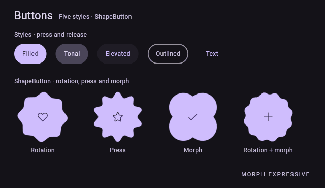 | 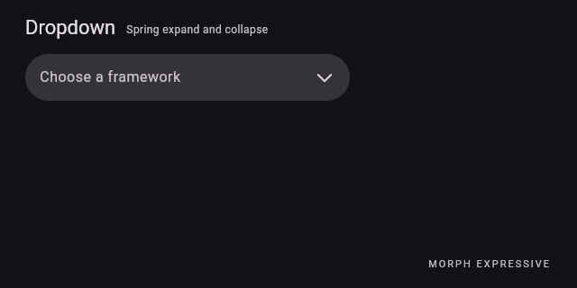 |
| **Segmented toggle** | **Text fields** |
| 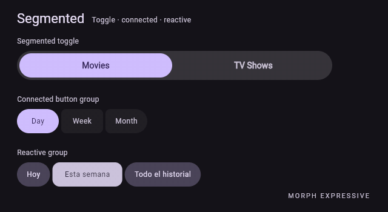 | 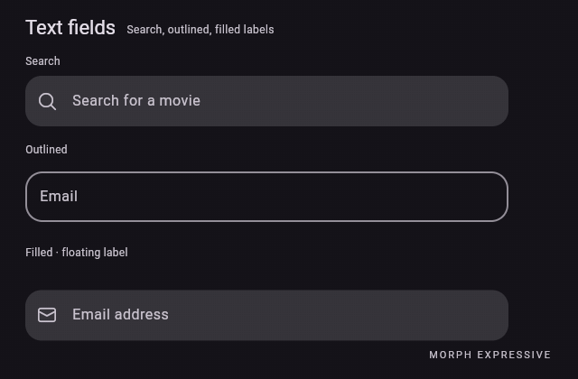 |
| **Chips** | **Sliders** |
| 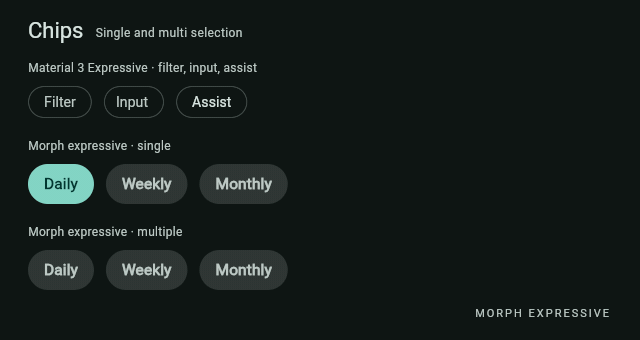 | 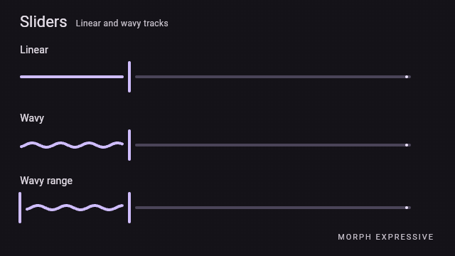 |
| **Loading indicators** | **Navigation** |
| 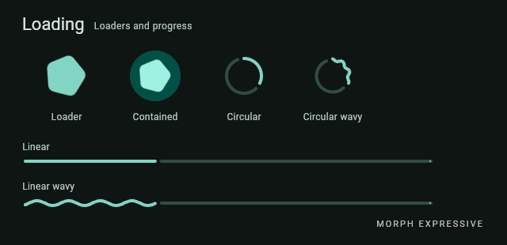 | 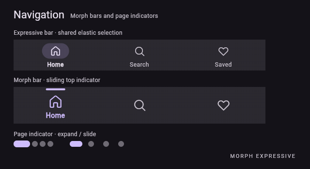 |
| **Morph navigation + page indicator** | **Morph rail + drawer** |
| 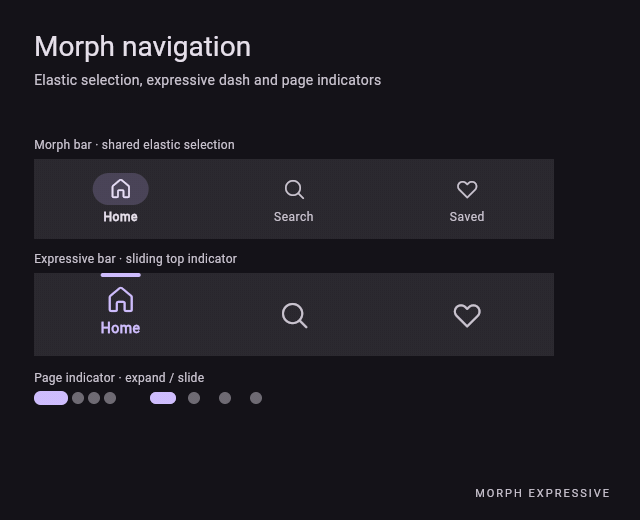 | 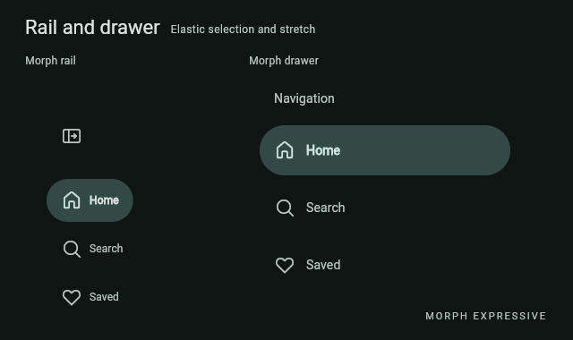 |
| **List items and swipe actions** | **Floating dialogs** |
| 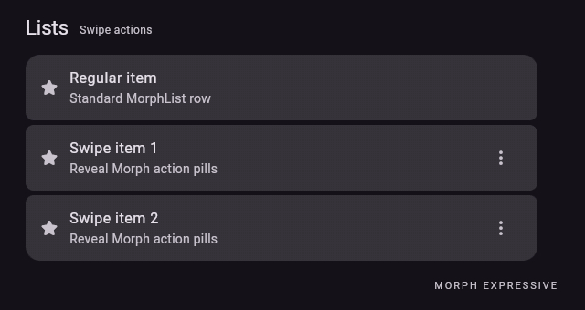 | 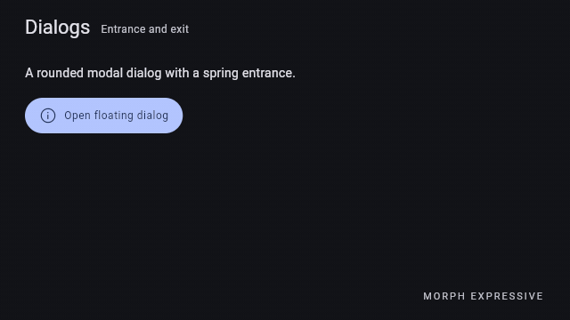 |

## Documentation

- [Getting started](https://github.com/Bruno0416/morph_expressive/blob/main/doc/GETTING_STARTED.md)
- [Theming and typography](https://github.com/Bruno0416/morph_expressive/blob/main/doc/THEMING.md)
- [Components](https://github.com/Bruno0416/morph_expressive/blob/main/doc/COMPONENTS.md)
- [Frosted surfaces](doc/FROSTED_SURFACES.md)
- [Blur-safe geometric scrolling](doc/MORPH_SCROLL.md)
- [Motion](https://github.com/Bruno0416/morph_expressive/blob/main/doc/MOTION.md)
- [Preview](https://github.com/Bruno0416/morph_expressive/blob/main/doc/PREVIEW.md)
- [Changelog](CHANGELOG.md)

For a practical interactive example of buttons, chips, text fields,
list swipe actions, and dialogs, see
[`example/main.dart`](https://github.com/Bruno0416/morph_expressive/blob/main/example/main.dart)
and its [usage guide](example/README.md).

## Development

```bash
flutter pub get
bash tool/check.sh
cd preview
flutter run -d web-server --web-port 8080
```

The preview is a separate Flutter application with a responsive component
gallery. To regenerate existing animated captures, run
`bash tool/generate_component_gifs.sh` from the repository root (requires
Flutter, Node.js, Python 3 and FFmpeg). See the [preview guide](doc/PREVIEW.md)
for details.

## Credits and license

Morph Expressive is an independent fork of
[Material 3 Expressive](https://github.com/paadevelopments/material_3_expressive)
by Paa Developments (MIT). The original implementations are modified directly
rather than wrapped.

Icon assets come from Fluent Icons Kit, distributed as a separate dependency.
See [LICENSE](LICENSE), [NOTICE](NOTICE) and the source headers for licensing
and attribution.

Morph Expressive is not affiliated with Google or the upstream maintainers.
