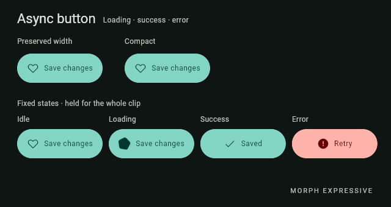
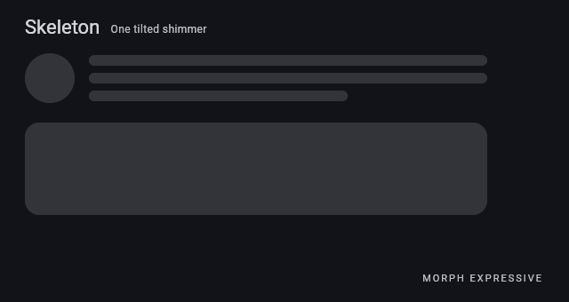
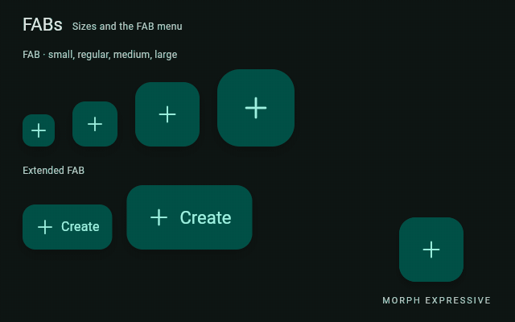
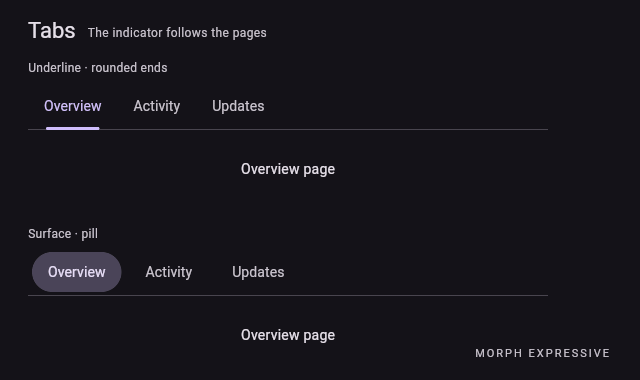

# Morph Expressive

Morph Expressive is a Flutter design system inspired by Material 3 Expressive. It
builds on its ideas with a focus on symmetry, rounded shapes, balanced colors,
and smooth animations.

The goal is to make components look and feel consistent while exploring new
styles and interactions beyond Material 3 Expressive.

## What 0.8.0 adds

- **Controlled operations and placeholders:** `MorphAsyncButton` and
  `MorphSkeleton` / `MorphSkeletonGroup` with one coordinated, tiltable shimmer.
- **Shapes:** an own geometry engine, a shape catalog, `MorphShapeButton` with
  rotation and press response, and loaders built on the same engine.
- **Buttons and groups:** 90/160 ms press response, automatic width and a
  configurable gap for connected groups, and `MorphReactiveButtonGroup`.
- **FAB menu:** a single main surface that morphs continuously while the items
  open and close.
- **Tabs:** a continuous indicator (rounded underline or surface) that follows
  the real page swipe.
- **Menus:** desktop submenus open on hover by default (click is configurable),
  plus semantics fixes.
- **Rendering fixes:** edge antialiasing, clipping, splash and exact 360° rotation.

Everything is additive on top of 0.7.x. See the
[upgrade guide](doc/UPGRADE_0_8_0.md) and the [changelog](CHANGELOG.md).
Publication of 0.8.0 is pending.

## Animated component previews

Captured from Morph Expressive running in Flutter Web (dark theme, no cursor).

### Operations and placeholders

| | |
|:---:|:---:|
| **Async button** | **Skeleton** |
|  |  |

### FAB menu and buttons

| | |
|:---:|:---:|
| **FABs and FAB menu** | **Buttons and ShapeButton** |
|  |  |

### Groups and tabs

| | |
|:---:|:---:|
| **Segmented, connected and reactive groups** | **Tabs** |
|  |  |

### Indicators, navigation and the rest of the catalog

| | |
|:---:|:---:|
| **Loaders and progress** | **Morph navigation** |
|  |  |
| **Dropdown** | **Lists and swipe actions** |
|  |  |
| **Dialogs** | **Chips** |
|  |  |
| **Text fields** | **Sliders** |
|  |  |

## Requirements

- Flutter >= 3.47.0, Dart ^3.13.0.
- Uses the `material_ui` package for Material widgets.
- No specific routing or state-management package is required.

## Installation

```yaml
dependencies:
  morph_expressive: ^0.8.0
```

Run `flutter pub get` after updating the dependency. 0.8.0 is not published yet:
until it is, use a Git or path dependency pointing at this checkout.

## Quick start

```dart
import 'package:material_ui/material_ui.dart'
    show Center, Color, MaterialApp, Scaffold, Text, runApp;
import 'package:morph_expressive/morph_expressive.dart'
    show MorphButton, MorphTheme, MorphThemeData;

void main() {
  const seed = Color(0xFF6750A4);
  final theme = MorphThemeData.light(seedColor: seed);

  runApp(
    MaterialApp(
      theme: theme.toThemeData(),
      home: MorphTheme(
        data: theme,
        child: Scaffold(
          body: Center(
            child: MorphButton(
              onPressed: () {},
              label: const Text('Continue'),
            ),
          ),
        ),
      ),
    ),
  );
}
```

This example uses a fixed light theme. For dynamic brightness, keep `MorphTheme`
and the host Material theme synchronized. `MaterialApp.router` is supported.

## Where to go next

- **Components:** [catalog](doc/COMPONENTS.md), the runnable
  [example](example/main.dart) and the [preview](doc/PREVIEW.md) (a component
  gallery plus labs for operations, shapes and tabs).
- **Customization:** [theming](doc/THEMING.md), [motion](doc/MOTION.md) and
  [reduced motion](doc/REDUCED_MOTION_ACCESSIBILITY.md).
- **New in 0.8.0:** [operations and skeleton](doc/OPERATION_LOADING.md),
  [shapes and renderers](doc/SHAPE_ENGINE.md), [tabs](doc/TABS.md),
  [visual and interaction fixes](doc/R3_VISUAL_FIXES.md).
- **Navigation, surfaces and scrolling:** [navigation](doc/NAVIGATION_MORPH.md),
  [frosted surfaces](doc/FROSTED_SURFACES.md),
  [blur-safe scrolling](doc/MORPH_SCROLL.md).
- **Compatibility:** [upgrade from 0.7.x](doc/UPGRADE_0_8_0.md),
  [pub.dev compatibility](doc/PUB_DEV_COMPATIBILITY.md) and the
  [final report for 0.8.0](doc/RELEASE_0_8_0.md).

## Development

```bash
flutter pub get
bash tool/check.sh
cd preview
flutter run -d web-server --web-port 8080
```

The preview is a separate Flutter application. To regenerate the animated
captures, run `bash tool/generate_component_gifs.sh` from the repository root
(requires Flutter, Node.js, Python 3 and FFmpeg); see the
[preview guide](doc/PREVIEW.md).

## Credits and license

Morph Expressive is an independent fork of
[Material 3 Expressive](https://github.com/paadevelopments/material_3_expressive)
by Paa Developments (MIT). The original implementations are modified directly
rather than wrapped.

Icon assets come from Fluent Icons Kit, distributed as a separate dependency.
See [LICENSE](LICENSE), [NOTICE](NOTICE) and the source headers for licensing
and attribution.

Morph Expressive is not affiliated with Google or the upstream maintainers.
