<p align="center">
  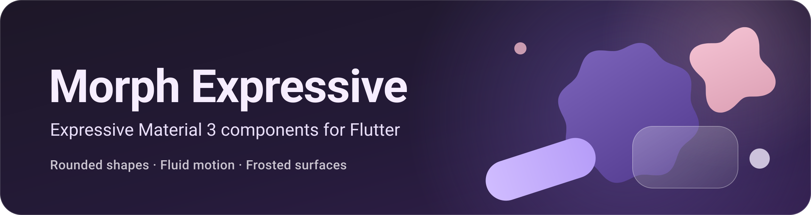
</p>

# Morph Expressive

[](https://pub.dev/packages/morph_expressive)
[](LICENSE)
[](https://flutter.dev)
[](https://dart.dev)

Morph Expressive is a Flutter design system that builds on Material 3
Expressive with a focus on symmetry, rounded shapes, balanced colors and smooth
animations. Components share one theme, one motion language and one
configuration model, so a screen built from them looks and feels consistent
while exploring styles and interactions beyond the Material 3 Expressive
reference.

## Why Morph Expressive

- **One API, two axes.** Pick a visual type with a named constructor and a color
  role with `variant`; cards also take an opaque or frosted finish with `surface`.
- **Expressive by default.** An own shape engine, springy press feedback, morphing
  FAB menus, tabs whose indicator follows the page swipe and coordinated
  shimmer placeholders.
- **Themed from one seed.** `MorphColorScheme.fromSeed` and `MorphThemeData`
  drive light and dark colors, typography and a global density.
- **Desktop aware.** Compact, standard and comfortable density, plus context
  menus with submenus and keyboard support.
- **Respects the user.** Reduced-motion handling and a frosted legibility floor
  (4.5:1 text contrast on `surface: .frosted` cards) are built in.
- **A single import.** Everything is exported from
  `package:morph_expressive/morph_expressive.dart`.

## Visual showcase

Captured from Morph Expressive running in Flutter Web (dark theme).

### Actions

<table>
  <tr>
    <td align="center" valign="top" width="50%">
      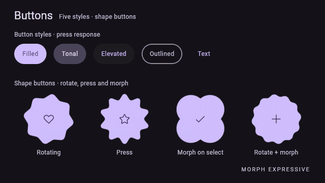<br>
      <sub>Five button types, each shown with its press response, followed by shape buttons that morph when pressed.</sub>
    </td>
    <td align="center" valign="top" width="50%">
      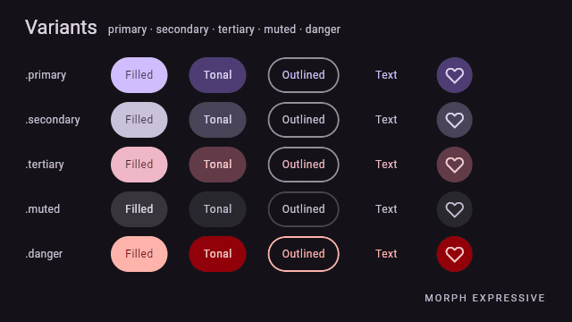<br>
      <sub>The same button types recolored with <code>variant</code> roles: primary, secondary, tertiary, muted and danger.</sub>
    </td>
  </tr>
  <tr>
    <td align="center" valign="top" width="50%">
      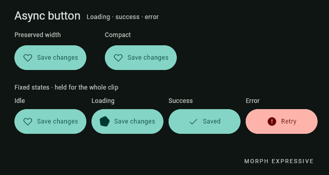<br>
      <sub><code>MorphAsyncButton</code> going from loading to success and to error without shifting the layout.</sub>
    </td>
    <td align="center" valign="top" width="50%">
      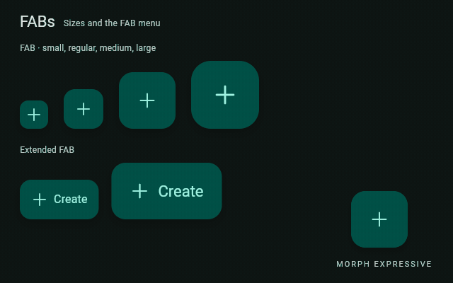<br>
      <sub>FAB menu with one main surface that morphs continuously as items open and close.</sub>
    </td>
  </tr>
</table>

### Selection and input

<table>
  <tr>
    <td align="center" valign="top" width="50%">
      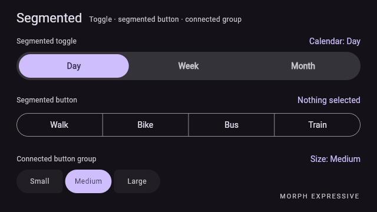<br>
      <sub>A toggle whose pill glides between options, a multi-select segmented button and a connected group whose neighbors squish.</sub>
    </td>
    <td align="center" valign="top" width="50%">
      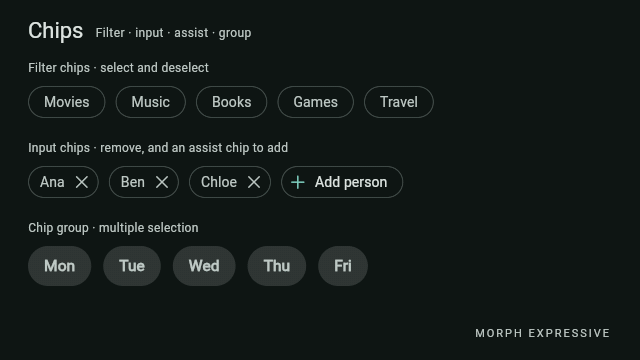<br>
      <sub>Filter chips, input chips removed and re-added with an assist chip, and a chip group with a shared morphing pill.</sub>
    </td>
  </tr>
  <tr>
    <td align="center" valign="top" width="50%">
      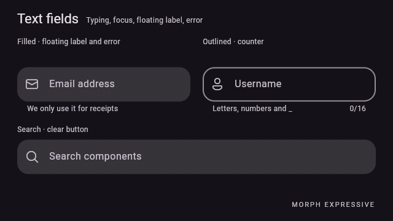<br>
      <sub>Typing into filled, outlined and search fields: floating label, validation error, character counter and clear button.</sub>
    </td>
    <td align="center" valign="top" width="50%">
      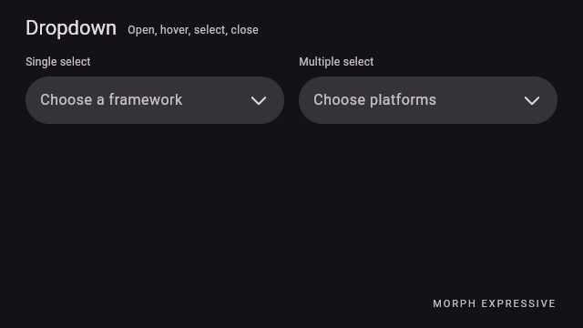<br>
      <sub>Single-select and multi-select dropdown menus: open, hover, choose an option and close.</sub>
    </td>
  </tr>
</table>

### Controls and feedback

<table>
  <tr>
    <td align="center" valign="top" width="50%">
      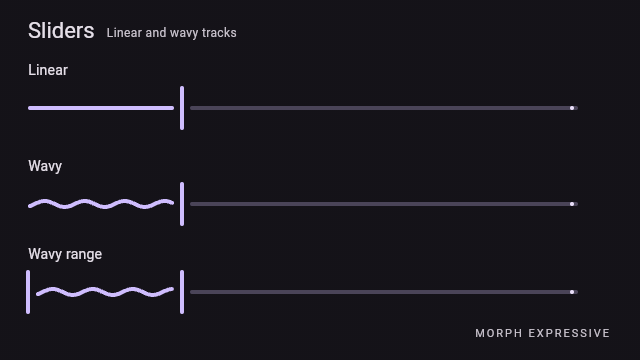<br>
      <sub>A linear slider, a wavy slider and a wavy range slider dragged by pointer.</sub>
    </td>
    <td align="center" valign="top" width="50%">
      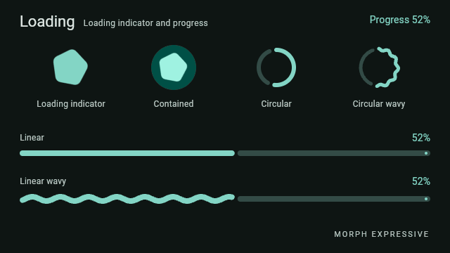<br>
      <sub>Free and contained loading indicators, plus circular, circular wavy and linear progress.</sub>
    </td>
  </tr>
</table>

### Navigation

<table>
  <tr>
    <td align="center" valign="top" width="50%">
      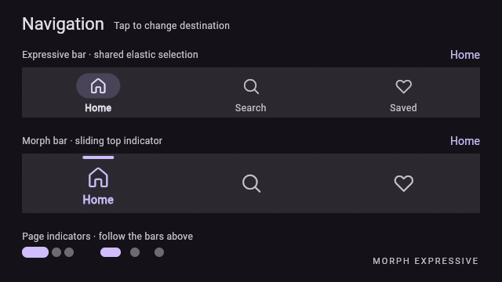<br>
      <sub>Two navigation bars changing destination on tap, with elastic selection.</sub>
    </td>
    <td align="center" valign="top" width="50%">
      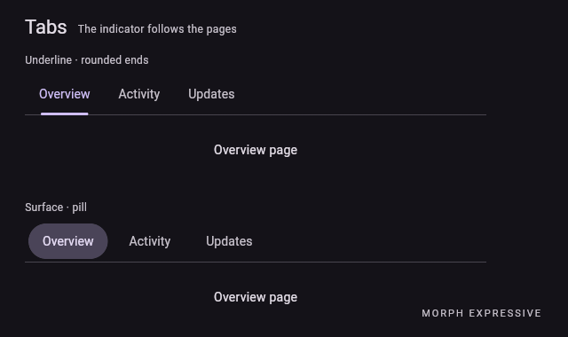<br>
      <sub>Tabs whose rounded underline or pill surface follows the real page swipe.</sub>
    </td>
  </tr>
</table>

### Desktop, density and frosted surfaces

<table>
  <tr>
    <td align="center" valign="top" width="50%">
      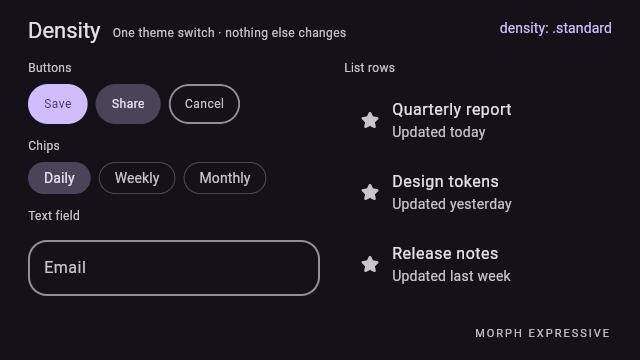<br>
      <sub>One global <code>MorphDensity</code> switch (compact, standard, comfortable); nothing else changes.</sub>
    </td>
    <td align="center" valign="top" width="50%">
      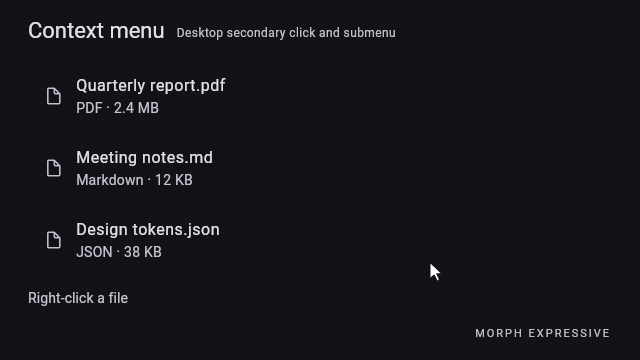<br>
      <sub>Desktop context menu: secondary click opens it at the pointer, rows highlight on hover, a submenu opens and an action closes it.</sub>
    </td>
  </tr>
  <tr>
    <td align="center" valign="top" colspan="2">
      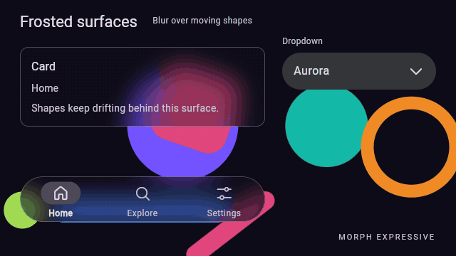<br>
      <sub>Frosted surfaces on components that support them: a card, an opened dropdown panel and a floating navigation bar blur the shapes drifting behind them.</sub>
    </td>
  </tr>
</table>

See [Density and context menus](doc/DENSITY_AND_CONTEXT_MENUS.md) and [Frosted surfaces](doc/FROSTED_SURFACES.md).

## Features

- **Actions:** buttons, icon buttons, async buttons, split buttons, button
  groups, segmented buttons, shape buttons, FABs, extended FABs, FAB menus and
  toolbars.
- **Selection and input:** checkbox, radio, switch, chips, sliders (linear,
  centered, wavy, range), dropdown menus, text fields, date and time pickers.
- **Containment:** cards, carousel, lists with swipe actions, dialogs, bottom
  and side sheets, dividers.
- **Navigation:** app bars (including frosted), navigation bar, rail, drawer,
  tabs, page indicators, search.
- **Feedback:** badges, progress and loading indicators, skeletons, snackbars,
  tooltips, refresh indicator.
- **Foundations:** seeded color schemes, typography, motion tokens, a shape
  catalog and engine, frosted surfaces and global density.

## Installation

```bash
flutter pub add morph_expressive
```

or add the dependency to `pubspec.yaml` once 1.0.0 is available on pub.dev:

```yaml
dependencies:
  morph_expressive: ^1.0.0
```

Until then, use a Git or path dependency pointing at this repository. Morph
Expressive uses the `material_ui` package for host Material widgets, which the
examples import alongside it. No specific routing or state-management package
is required.

## Quick start

```dart
import 'package:material_ui/material_ui.dart'
    show Center, Color, Scaffold, Text, runApp;
import 'package:morph_expressive/morph_expressive.dart'
    show MorphButton, MorphMaterialApp, MorphThemeData;

void main() {
  runApp(
    MorphMaterialApp(
      data: MorphThemeData.light(seedColor: const Color(0xFF6750A4)),
      home: Scaffold(
        body: Center(
          child: MorphButton.filled(
            variant: .tertiary,
            onPressed: () {},
            child: const Text('Continue'),
          ),
        ),
      ),
    ),
  );
}
```

`MorphMaterialApp` wires a `MaterialApp` to `MorphTheme` for you. If you already
own a `MaterialApp` or `MaterialApp.router`, wrap it with `MorphTheme` and keep
it synchronized with the host Material theme; see
[Getting started](doc/GETTING_STARTED.md).

## Theming and density

```dart
final theme = MorphThemeData.light(
  seedColor: const Color(0xFF6750A4),
  density: .compact, // compact | standard | comfortable
);
```

The seed produces a Material 3 tonal-spot color scheme; `MorphThemeData.dark`
and `MorphThemeData.fromMaterial` cover dark mode and existing Material themes.
`MorphDensity.standard` is the default and keeps the base Morph geometry. See
[Theming](doc/THEMING.md) and
[Density and context menus](doc/DENSITY_AND_CONTEXT_MENUS.md).

## Component API

Visual types are named constructors, `variant` picks a color role
(`primary`, `secondary`, `tertiary`, `muted`, `danger`; omitted keeps the
canonical Material 3 pairing). `MorphCard` also takes `surface` to pick `solid`
or `frosted`; floating surfaces (menus, dialogs, sheets) use `glass:`. Buttons
have no frosted finish.

| Component | Types | `variant` | `surface` |
| --- | --- | :---: | :---: |
| `MorphButton` | `.filled` `.tonal` `.elevated` `.outlined` `.text` | yes | no |
| `MorphAsyncButton` | loading, success and error states | yes | no |
| `MorphIconButton` | `.standard` `.filled` `.tonal` `.outlined` | yes | no |
| `MorphCard` | `.elevated` `.filled` `.outlined` | yes | yes |
| `MorphSplitButton`, `MorphButtonGroup`, `MorphShapeButton` | one per widget | yes | no |
| `MorphTextField` | `.filled` `.outlined` | no | no |
| `MorphChip` | `.assist` `.filter` `.input` `.suggestion` | no | no |

```dart
MorphButton.outlined(
  variant: .danger,
  onPressed: onDelete,
  child: const Text('Delete'),
);
```

Full reference: [Component API](doc/API_V1.md). Coming from an earlier
version: [Upgrading to the v1 component API](doc/UPGRADE_1_0_0.md).

## Widgetbook preview

The `preview/` directory is a separate Flutter application with a Widgetbook
catalog of every exported widget, global theme, seed and viewport controls, and
labs for operations, shapes and tabs. From the repository root:

```bash
flutter pub get
cd preview
flutter pub get
dart run build_runner build
flutter run -d web-server --web-hostname 127.0.0.1 --web-port 8081
```

Then open `127.0.0.1:8081` in a browser. Details are in the
[preview guide](doc/PREVIEW.md). The small runnable [example](example/main.dart)
needs no extra packages.

## Documentation

- [Documentation index](doc/README.md)
- [Getting started](doc/GETTING_STARTED.md) and [Component catalog](doc/COMPONENTS.md)
- [Component API](doc/API_V1.md) and [Upgrading to the v1 API](doc/UPGRADE_1_0_0.md)
- [Theming](doc/THEMING.md), [Motion](doc/MOTION.md) and
  [Reduced motion](doc/REDUCED_MOTION_ACCESSIBILITY.md)
- [Density and context menus](doc/DENSITY_AND_CONTEXT_MENUS.md)
- [Frosted surfaces](doc/FROSTED_SURFACES.md) and
  [Blur-safe scrolling](doc/MORPH_SCROLL.md)
- [Shapes and renderers](doc/SHAPE_ENGINE.md), [Tabs](doc/TABS.md) and
  [Operations and skeleton](doc/OPERATION_LOADING.md)
- [Navigation](doc/NAVIGATION_MORPH.md)
- [Changelog](CHANGELOG.md)

## Compatibility

- **SDK:** Flutter >= 3.47.0, Dart ^3.13.0.
- **Platforms declared in `pubspec.yaml`:** Android, iOS, Linux, macOS, Web and
  Windows. Morph Expressive is a widget library, not a native plugin.
- **Frosted surfaces:** each one costs a backdrop blur, which can be expensive
  on Web. Use them on in-flow controls over imagery or color rather than on
  long lists, and `webBackdropBlur: false` for a Web-specific fallback; see
  [Frosted surfaces](doc/FROSTED_SURFACES.md).

## Contributing

Issues and suggestions are welcome in the
[issue tracker](https://github.com/Bruno0416/morph_expressive/issues). To work
on the package, run `flutter pub get` and `bash tool/check.sh` from the
repository root. To regenerate the animated captures, run
`bash tool/generate_component_gifs.sh` (requires Flutter, Node.js, Python 3 and
FFmpeg); see the [preview guide](doc/PREVIEW.md).

## Credits and license

Morph Expressive is an independent fork of
[Material 3 Expressive](https://github.com/paadevelopments/material_3_expressive)
by Paa Developments (MIT). The original implementations are modified directly
rather than wrapped. Material 3 Expressive is used as a design reference.

Icon assets come from Fluent Icons Kit, distributed as a separate dependency.
See [LICENSE](LICENSE), [NOTICE](NOTICE) and the source headers for licensing
and attribution.

Morph Expressive is not affiliated with or endorsed by Google or the upstream
maintainers.
