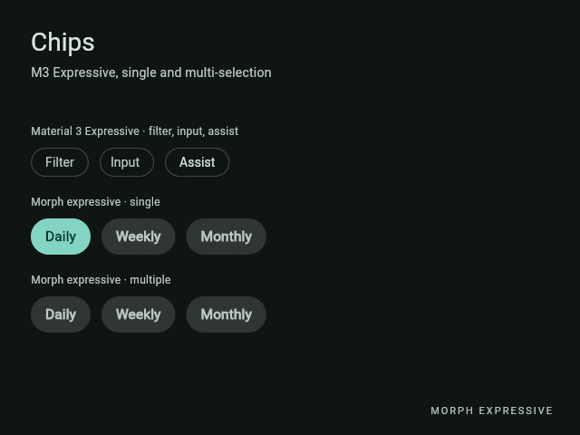
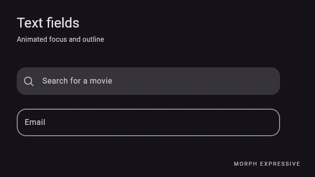
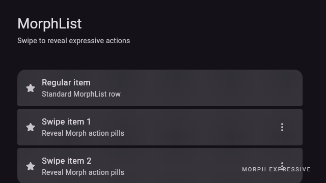

# Component catalog

Import `package:morph_expressive/morph_expressive.dart` to access public
components and foundations. The public `morph_components.dart` exports
components spanning 39 showcase families:

| Group | Families |
| --- | --- |
| Actions | Buttons, icon buttons, button groups, segmented buttons, split buttons, FABs, extended FABs, FAB menus, toolbars |
| Selection & input | Checkbox, radio, switch, chips, sliders (linear / centered / wavy / range), dropdown menus, text fields, date pickers, time pickers |
| Containment | Cards, carousel, lists, selection, dialogs, bottom sheets, side sheets, dividers |
| Navigation | App bars, navigation bar, rail, drawer, tabs, search |
| Feedback | Badges, progress indicators, loading indicator, refresh indicator, snackbars, tooltips |

The `preview/` gallery includes interactive examples by family. A public export
in the source inventory is not necessarily a standalone component requiring a
separate showcase scene.

To start from a smaller, application-style example, explore
[`example/main.dart`](../example/main.dart): it combines buttons, selections,
validated fields, swipeable lists and a modal dialog.

## Chip variants and selection

The standard MD3-inspired chips (filter, input and assist) are distinct from
`MorphChipToggle<T>`, which animates a connected selection pill. Its
**single-selection** mode remains the default: provide `selected` and
`onChanged`. `MorphSegmentedToggle<T>` is another single-selection family,
with its own stretchy selection indicator.

To enable **multiple selection**, retain the selected values in the parent
widget state and supply a `Set<T>`:

```dart
MorphChipToggle<String>(
  multiSelection: true,
  options: const [
    MorphChipToggleOption(value: 'Daily', label: 'Daily'),
    MorphChipToggleOption(value: 'Weekly', label: 'Weekly'),
    MorphChipToggleOption(value: 'Monthly', label: 'Monthly'),
  ],
  selectedValues: selectedPeriods,
  onSelectionChanged: (next) => setState(() => selectedPeriods = next),
)
```

Here `selectedPeriods` is a `Set<String>` field in a `State` class; the callback
returns a fresh unmodifiable set. Empty multi-selection is allowed.

**Motion rules (0.2.0):** from zero to one selected, a 4 px circle expands
uniformly and becomes the pill; from one to zero, it shrinks back into a
circle with fade. Adding a second/third chip duplicates a pill from the
nearest active selection with a trailing-edge delay. Removing a chip while
others remain merges its pill toward the nearest survivor. The default chip
motion is 289 ms with a 77 ms trailing-edge delay; use `duration` and
`stretchDelay` to customize it.



## Filled text fields and floating labels

A `MorphTextField` using `MorphTextFieldVariant.filled` places an empty,
unfocused label inside the filled surface. On focus it moves diagonally toward
the leading side **above** the surface, revealing `placeholder`; once populated
it remains above even after focus is lost. It uses `onSurface` while focused,
with slightly larger-than-`bodyMedium` default floating typography. The
`outlined` variant retains its existing placement and defaults.

```dart
MorphTextField(
  variant: MorphTextFieldVariant.filled,
  label: 'Email',
  placeholder: 'name@example.com',
  floatingLabelTextStyle: const TextStyle(fontSize: 17), // optional
)
```

Customize `floatingLabelTextStyle` on the widget or through
`MorphTextFieldTheme`; the inline label and typed content are unaffected.



### Validation error icons

`errorText` applies error styling and an accessible error message without
adding an icon by default. Opt into a custom `errorIcon` and set its location
with `MorphTextFieldErrorIconPosition.prefix` or `.suffix` (suffix is the
default). Both filled and outlined fields support either position. The
explicit error icon is only rendered when `errorText` is present, and can
coexist with your `leading` or `trailing` content. `showErrorIcon: true` is
retained for existing users of the built-in error glyph, but is now opt-in.

```dart
MorphTextField(
  label: 'Email',
  errorText: 'Please enter a valid address',
  errorIcon: const Icon(MorphIcons.error),
  errorIconPosition: MorphTextFieldErrorIconPosition.prefix,
  variant: MorphTextFieldVariant.outlined,
)
```

## Tabs and focus-driven scrolling

`MorphTabs` and `MorphTabs.sliver` now default to
`autoScrollToFocusedTab: false`. Switching or focusing a primary or secondary
tab does not automatically move its enclosing scroll viewport. Opt in with
`autoScrollToFocusedTab: true` if the app needs focus-following scrolling.
The animated indicator and keyboard focus behavior remain available.

## Swipe actions on Morph lists

Swipe actions are built into `MorphList`; no dependency on `flutter_slidable`
is required. Set `swipe` on each `MorphListItem` (a standalone item does
not provide the drag host). Swipe actions retain the standard Morph card
surface, spring motion, radii, pill buttons, and list spacing. Swipeable
rows do not inject a default trailing overflow icon; reveal them directly by
gesture or through a dismiss controller to keep the row chrome clean.

```dart
MorphList(
  itemCount: items.length,
  itemBuilder: (context, index) => MorphListItem(
    headline: items[index].title,
    swipe: MorphListItemSwipe(
      mode: MorphListSwipeMode.reveal,
      leading: [
        MorphListSwipeAction(
          icon: const Icon(MorphIcons.star),
          tooltip: 'Favorite',
          onPressed: () => favorite(items[index]),
        ),
      ],
      trailing: [
        MorphListSwipeAction(
          icon: const Icon(MorphIcons.archive),
          tooltip: 'Archive',
          onPressed: () => archive(items[index]),
        ),
      ],
    ),
  ),
)
```



Floating dialogs use the same expressive motion system; see the
[dialog capture](assets/gifs/dialogs.gif) for entrance and exit transitions.

`MorphListSwipeMode.reveal` only opens actions; `dismiss` performs a full
swipe; `both` supports both gestures. `MorphListSwipeAction` supports
`tooltip`, `semanticLabel`, `enabled`, `autoClose`, optional colors, and
`isPrimary` for full-swipe actions. Use `MorphDismissibleListController` to
reveal, dismiss or close a row from your app.

If you enable full dismissal, `onDismiss` returns a `Future<bool>`: `false`
restores the card, while `true` permits its animation and the optional primary
action. It is safe to await a confirmation dialog. Update the application
collection to reflect confirmed deletion and provide stable item identities
when items can reorder. A disabled `MorphListItem` ignores swipe commands.

## Haptic feedback

`MorphThemeData.hapticsEnabled` defaults to `true`; its
`hapticFeedback` defaults to `MorphHapticFeedback.light`. Globally disabling
haptics prevents Morph-managed controls from forcing a local impact. Local
component overrides support `inherit` and `none` where provided. See
[Theming](THEMING.md) for details and device limitations.

For constructor parameters and the complete public API, consult Dart API
references and the exports in `lib/`.
