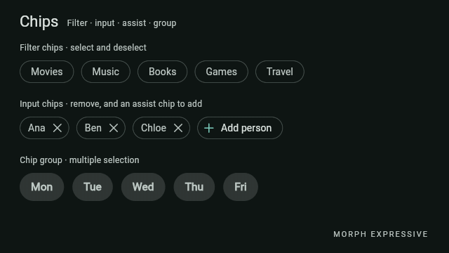
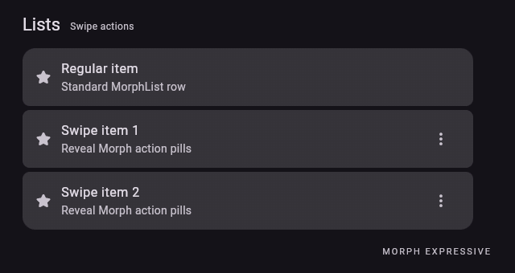

# Component catalog

`package:morph_expressive/morph_expressive.dart` exports 45 component library
files (`lib/morph_components.dart`) grouped below into 41 families, plus the
foundations (theme, color, motion, surfaces, shapes) and `FluentIcons`. All
snippets are compiled by `test/doc_examples_test.dart`; the same widgets, with
live knobs for theme, seed, density and viewport, are in the
[Widgetbook preview](PREVIEW.md).

How to read the tables:

- **Types**: named constructors that select the visual type.
- **`variant`**: `MorphVariant? variant` is the shared color role (`primary`,
  `secondary`, `tertiary`, `muted`, `danger`; `null` keeps the canonical
  Material 3 pairing). **`surface`**: `MorphSurface.solid` (default) or
  `.frosted`. Both are described in [Component API](API_V1.md).
- In families without the shared `variant`, a parameter that is also called
  `variant` (tabs, app bars, menus, dialogs, sheets, toolbars, lists, loading
  indicator, text field) selects a *structural* type, not a color role.
- **Glass**: floating surfaces take `glass:` ([Frosted surfaces](FROSTED_SURFACES.md)).

## Actions

| Family | Widgets | Types / constructors | `variant` | `surface` |
| --- | --- | --- | :---: | :---: |
| Buttons | `MorphButton` | `.filled` `.tonal` `.elevated` `.outlined` `.text` `.icon`; default is filled | yes | yes |
| Async button | `MorphAsyncButton` | `style: MorphButtonStyle`; states `MorphOperationState` | yes | yes |
| Icon buttons | `MorphIconButton` | `.standard` `.filled` `.tonal` `.outlined`; `type: MorphIconButtonType` | yes | yes |
| Button groups | `MorphButtonGroup`, `MorphButtonGroupAction`, `MorphReactiveButtonGroup` | `type: MorphButtonGroupType.standard / .connected`, `style`, multi-select | yes (forwarded) | no |
| Split buttons | `MorphSplitButton<T>`, `MorphSplitButtonItem<T>` | menu or bottom-sheet overflow | yes | no |
| Shape buttons | `MorphShapeButton`, `MorphShapeView` | shape-engine geometry ([SHAPE_ENGINE.md](SHAPE_ENGINE.md)) | yes | no |
| Segmented | `MorphSegmentedButton<T>`, `MorphSegmentedToggle<T>`, `MorphSegmentedToggleOption<T>` | single or multi select; toggle has a stretchy indicator | no | no |
| FABs | `MorphFab`, `MorphExtendedFab`, `MorphFabMenu` | `MorphFabColor` / `MorphFabMenuColorSet` (role + tone) | no | no |
| Toolbars | `MorphToolbar` | `.docked` `.floating` | no | no |

## Selection and input

| Family | Widgets | Notes |
| --- | --- | --- |
| Chips | `MorphChip` | `.assist` `.filter` `.input` `.suggestion`; `MorphChipGroup`; `MorphChipToggle<T>` (animated connected pill, single or multi) |
| Checkbox, radio, switch | `MorphCheckbox`, `MorphRadio<T>`, `MorphRadioGroup<T>`, `MorphSwitch` | control size and target are semantic (not density-scaled) |
| Sliders | `MorphSlider` (`.centered` `.vertical` `.verticalCentered` `.wavy` `.wavyCentered`), `MorphRangeSlider` (`.wavy`) | `divisions` give one tick per step |
| Text fields | `MorphTextField` | `.filled` `.outlined`; `errorText`, `onUnfocus`, error icon |
| Dropdown menus | `MorphDropdownMenu<T>`, `MorphDropdownItem<T>`, `MorphDropdownController<T>` | `glass:` applies to the opened panel |
| Search | `MorphSearchBar`, `MorphSearchAnchor` (`.bar`), `MorphSliverSearchBar` | |
| Date and time pickers | `MorphDatePickerDialog`, `MorphDateRangePickerDialog`, `MorphCalendarDatePicker`, `MorphTimePickerDialog`, `MorphDialTimePicker`, input form fields | fixed Material geometry |
| Selection mode | `MorphSelection`, `MorphSelectionAppBar`, `MorphSelectionScope` | multi-select for lists |

## Containment

| Family | Widgets | Notes |
| --- | --- | --- |
| Cards | `MorphCard`, `MorphCardGroup` | `.elevated` `.filled` `.outlined`; `type: MorphCardType`; `variant`; `surface`; swipe and container transform |
| Lists | `MorphList` (`.scrollable` `.sliver`), `MorphListItem`, `MorphExpandableItem`, `MorphExpandableSublist` | swipe actions, reorder, expandable rows |
| Carousel | `MorphCarousel`, `MorphCarouselView` (`.builder` `.weighted` `.weightedBuilder`) | |
| Dialogs | `MorphDialog`, `MorphFullScreenDialog`, `MorphAdaptiveDialog` | `MorphDialog.show`, `.showFullScreen`, `.showAdaptive`; `glass:` |
| Sheets | `MorphBottomSheet` (`.standard`), `MorphSideSheet` (`.standard`) | `glass:` through the show helpers |
| Divider | `MorphDivider` | |

## Navigation

| Family | Widgets | Notes |
| --- | --- | --- |
| Navigation bar | `MorphNavigationBar` (`.expressive` `.morph`), `MorphNavigationBarDestination`, `MorphNavigationBarHost` | floating, scroll-aware host |
| Rail and drawer | `MorphNavigationRail` (`.morph`), `MorphNavigationDrawer` (`.morph`) | |
| Tabs | `MorphTabs` (`.sliver`), `MorphTab`, `MorphTabsView`, `MorphTabsController` | continuous indicator linked to page progress ([TABS.md](TABS.md)) |
| App bars | `MorphAppBar` (`.top` `.bottom` `.search` `.sliver` `.frosted`) | `MorphAppBarGlass`, scroll behavior |
| Page indicator | `MorphPageIndicator` | |

## Feedback and overlays

| Family | Widgets | Notes |
| --- | --- | --- |
| Progress | `MorphProgressIndicator` (`.linear` `.linearWavy` `.circular` `.circularWavy`), `MorphLoadingIndicator` | wavy motion is static under reduced motion |
| Skeleton | `MorphSkeleton` (`.line` `.lines` `.avatar` `.image`), `MorphSkeletonGroup` | one coordinated shimmer ([OPERATION_LOADING.md](OPERATION_LOADING.md)) |
| Refresh | `MorphRefreshIndicator` (`.contained` `.material` `.adaptive` `.noSpinner`) | |
| Badges | `MorphBadge` | density-aware ([Density](DENSITY_AND_CONTEXT_MENUS.md)) |
| Snackbar | `MorphSnackbar`, `MorphSnackbarHost` | |
| Tooltips | `MorphTooltip` | |
| Menus | `MorphMenu`, `MorphMenuEntry`, `MorphMenuSubmenu`, `MorphMenuDivider`, `showMorphMenu`, `MorphContextMenuRegion`, `showMorphContextMenu` | desktop presentation ([Density](DENSITY_AND_CONTEXT_MENUS.md)) |

## Buttons

Every visual type is a named constructor. `MorphButton.text` takes only a
`child`; the other types take `child`, or `icon` and `label`.

```dart
Widget buttonFamilies(VoidCallback onPressed) {
  return Wrap(
    spacing: 8,
    runSpacing: 8,
    children: [
      MorphButton.filled(onPressed: onPressed, child: const Text('Filled')),
      MorphButton.tonal(onPressed: onPressed, child: const Text('Tonal')),
      MorphButton.elevated(onPressed: onPressed, child: const Text('Elevated')),
      MorphButton.outlined(onPressed: onPressed, child: const Text('Outlined')),
      MorphButton.text(onPressed: onPressed, child: const Text('Text')),
      MorphButton.icon(
        onPressed: onPressed,
        icon: Icon(FluentIcons.line.add),
        label: const Text('With icon'),
      ),
      // Sizes and shapes are independent from the visual type.
      MorphButton.filled(
        size: MorphButtonSize.lg,
        shape: MorphButtonShape.square,
        onPressed: onPressed,
        child: const Text('Large square'),
      ),
    ],
  );
}
```

`MorphAsyncButton` is *controlled*: the app owns the
`MorphOperationState` (`idle`, `loading`, `success`, `error`) and the button
animates between them, keeping its width stable by default
(`MorphOperationPresentation.preserveWidth`) and blocking taps while loading.

```dart
class SaveButton extends StatefulWidget {
  const SaveButton({super.key});

  @override
  State<SaveButton> createState() => _SaveButtonState();
}

class _SaveButtonState extends State<SaveButton> {
  MorphOperationState state = MorphOperationState.idle;

  Future<void> save() async {
    setState(() => state = MorphOperationState.loading);
    try {
      await Future<void>.delayed(const Duration(seconds: 1)); // your request
      setState(() => state = MorphOperationState.success);
    } catch (_) {
      setState(() => state = MorphOperationState.error);
    }
  }

  @override
  Widget build(BuildContext context) {
    return MorphAsyncButton(
      label: 'Save changes',
      state: state,
      labels: const {
        MorphOperationState.success: 'Saved',
        MorphOperationState.error: 'Retry',
      },
      onPressed: save,
    );
  }
}
```

## Icon buttons and button groups

Always give icon-only controls a `tooltip` (it doubles as the semantic label).

```dart
Widget iconButtons(VoidCallback onPressed) {
  return Row(
    spacing: 8,
    children: [
      MorphIconButton.standard(
        onPressed: onPressed,
        tooltip: 'Favorite',
        icon: Icon(FluentIcons.line.heart),
      ),
      MorphIconButton.filled(
        onPressed: onPressed,
        tooltip: 'Add',
        icon: Icon(FluentIcons.line.add),
      ),
      MorphIconButton.tonal(
        variant: .secondary,
        onPressed: onPressed,
        tooltip: 'Edit',
        icon: Icon(FluentIcons.line.edit),
      ),
      MorphIconButton.outlined(
        variant: .danger,
        onPressed: onPressed,
        tooltip: 'Delete',
        icon: Icon(FluentIcons.line.delete),
      ),
    ],
  );
}
```

A *connected* group joins its segments with a 2 dp gap; inner corners morph on
press and selection. `selectedIndex` / `onSelectedIndexChanged` select one,
`multiSelect` with `selectedIndices` / `onSelectedIndicesChanged` select several.
When the actions do not fit, `overflow` chooses between `none` (no special
strategy), `scroll` (default) and `menu`, which collapses trailing actions into a
popup or a bottom sheet (`overflowMenuStyle`).

```dart
class PeriodPicker extends StatefulWidget {
  const PeriodPicker({super.key});

  @override
  State<PeriodPicker> createState() => _PeriodPickerState();
}

class _PeriodPickerState extends State<PeriodPicker> {
  int? selected = 1;

  @override
  Widget build(BuildContext context) {
    return MorphButtonGroup(
      type: MorphButtonGroupType.connected,
      style: MorphButtonStyle.tonal,
      selectedIndex: selected,
      onSelectedIndexChanged: (index) => setState(() => selected = index),
      actions: const [
        MorphButtonGroupAction(label: Text('Day')),
        MorphButtonGroupAction(label: Text('Week')),
        MorphButtonGroupAction(label: Text('Month')),
      ],
    );
  }
}
```

## Text fields

`MorphTextField.filled` puts an empty, unfocused label inside the surface; on
focus it moves above the surface, revealing `placeholder`, and stays there once
there is content. `.outlined` keeps the label on the outline.
`floatingLabelTextStyle` (widget or `MorphTextFieldTheme`) overrides the label
typography. When two filled fields sit side by side, set
`reserveFloatingLabelSpace: true` on both so their surfaces stay level.

```dart
Widget textFields({
  required TextEditingController controller,
  required String? emailError,
  required ValueChanged<String> validate,
}) {
  return Column(
    spacing: 16,
    children: [
      MorphTextField.filled(
        controller: controller,
        label: 'Email',
        placeholder: 'name@example.com',
        errorText: emailError,
        onUnfocus: validate,
      ),
      MorphTextField.outlined(
        label: 'Search',
        supportingText: 'Press enter to search',
      ),
    ],
  );
}
```

`onUnfocus` receives the latest text once, when focus is lost (tap outside, Tab,
or `FocusNode.unfocus()`); it is a notification, not a validator. Store the
message in your state and pass it as `errorText`; the field handles the error
color and announces the message to assistive technology. An error icon is opt-in:
`errorIcon` with `MorphTextFieldErrorIconPosition.prefix` or `.suffix` (default).

```dart
class EmailField extends StatefulWidget {
  const EmailField({super.key});

  @override
  State<EmailField> createState() => _EmailFieldState();
}

class _EmailFieldState extends State<EmailField> {
  String? emailError;

  @override
  Widget build(BuildContext context) {
    return MorphTextField.outlined(
      label: 'Email',
      onUnfocus: (value) {
        setState(() {
          emailError = value.trim().contains('@')
              ? null
              : 'Enter a valid email';
        });
      },
      errorText: emailError,
      errorIcon: const Icon(MorphIcons.error),
      errorIconPosition: MorphTextFieldErrorIconPosition.prefix,
    );
  }
}
```

## Chips

`MorphChip` covers the four Material chip roles. `MorphChipToggle<T>` is a
different widget: an animated connected selection pill that supports a single
value (`selected` / `onChanged`) or several (`multiSelection`, `selectedValues`,
`onSelectionChanged`, with an empty selection allowed). Keep the selection in
your state and return a new set.

```dart
Widget chips() {
  return Wrap(
    spacing: 8,
    children: [
      MorphChip.assist(label: 'Directions', onPressed: () {}),
      MorphChip.filter(label: 'Open now', selected: true, onPressed: () {}),
      MorphChip.input(label: 'Ada', onPressed: () {}, onDeleted: () {}),
      MorphChip.suggestion(label: 'Nearby', onPressed: () {}),
    ],
  );
}
```

```dart
class PeriodChips extends StatefulWidget {
  const PeriodChips({super.key});

  @override
  State<PeriodChips> createState() => _PeriodChipsState();
}

class _PeriodChipsState extends State<PeriodChips> {
  Set<String> selectedPeriods = <String>{'Daily'};

  @override
  Widget build(BuildContext context) {
    return MorphChipToggle<String>(
      multiSelection: true,
      options: const [
        MorphChipToggleOption(value: 'Daily', label: 'Daily'),
        MorphChipToggleOption(value: 'Weekly', label: 'Weekly'),
        MorphChipToggleOption(value: 'Monthly', label: 'Monthly'),
      ],
      selectedValues: selectedPeriods,
      onSelectionChanged: (next) => setState(() => selectedPeriods = next),
    );
  }
}
```

Default chip motion is 289 ms with a 77 ms trailing-edge delay (`duration`,
`stretchDelay`). `organicBloomIntensity` and `organicStretchIntensity` can be
set to `0` to disable the organic effects ([Motion](MOTION.md)).



## Navigation and tabs

`MorphNavigationBar.expressive` shows the animated icon pill and
`MorphNavigationBar.morph` the sliding dash; the default constructor is the
standard bar. Destinations take `IconData` (`icon`, `selectedIcon`) or custom
widgets (`iconWidget`, `selectedIconWidget`), plus `label` and `badgeCount`.
See [NAVIGATION_MORPH.md](NAVIGATION_MORPH.md) for the scroll-aware host and
frosted bars.

```dart
class AppNavigation extends StatefulWidget {
  const AppNavigation({super.key});

  @override
  State<AppNavigation> createState() => _AppNavigationState();
}

class _AppNavigationState extends State<AppNavigation> {
  int index = 0;

  @override
  Widget build(BuildContext context) {
    return MorphNavigationBar.expressive(
      selectedIndex: index,
      onDestinationSelected: (next) => setState(() => index = next),
      destinations: [
        MorphNavigationBarDestination(
          icon: FluentIcons.line.home,
          selectedIcon: FluentIcons.filled.home,
          label: 'Home',
        ),
        MorphNavigationBarDestination(
          icon: FluentIcons.line.search,
          label: 'Search',
        ),
        MorphNavigationBarDestination(
          icon: FluentIcons.line.mail,
          label: 'Mail',
          badgeCount: 3,
        ),
      ],
    );
  }
}
```

`MorphTabs` and `MorphTabsView` share a `MorphTabsController` so the indicator
follows the real swipe progress. `autoScrollToFocusedTab` is `false` by default:
focusing a tab does not move the enclosing scroll view unless you opt in.
Details: [TABS.md](TABS.md).

```dart
class OverviewTabs extends StatefulWidget {
  const OverviewTabs({super.key});

  @override
  State<OverviewTabs> createState() => _OverviewTabsState();
}

class _OverviewTabsState extends State<OverviewTabs> {
  final MorphTabsController controller = MorphTabsController();
  int tab = 0;

  @override
  void dispose() {
    controller.dispose();
    super.dispose();
  }

  @override
  Widget build(BuildContext context) {
    return Column(
      children: [
        MorphTabs(
          controller: controller,
          tabs: const [
            MorphTab(label: 'Overview'),
            MorphTab(label: 'Activity'),
          ],
          selectedIndex: tab,
          onTabSelected: (index) => setState(() => tab = index),
        ),
        SizedBox(
          height: 80,
          child: MorphTabsView(
            controller: controller,
            selectedIndex: tab,
            onTabSelected: (index) => setState(() => tab = index),
            children: const [Text('Overview page'), Text('Activity page')],
          ),
        ),
      ],
    );
  }
}
```

## Progress, loading and skeletons

```dart
Widget progress(double value) {
  return Column(
    spacing: 12,
    children: [
      MorphProgressIndicator.linear(value: value),
      MorphProgressIndicator.linearWavy(value: value),
      MorphProgressIndicator.circular(value: value, size: 48),
      const MorphProgressIndicator.circularWavy(size: 48), // indeterminate
      const MorphLoadingIndicator(size: 48),
    ],
  );
}
```

`MorphSkeletonGroup` crossfades from a placeholder to the real content and runs
a single shimmer (tiltable with `angle`) across every skeleton in the group.

```dart
Widget profilePlaceholder({required bool loading}) {
  return MorphSkeletonGroup(
    loading: loading,
    semanticLabel: 'Loading profile',
    placeholder: Column(
      children: [const MorphSkeleton.avatar(), MorphSkeleton.lines(count: 3)],
    ),
    child: const Text('Real content, same layout'),
  );
}
```

Determinate wavy indicators change amplitude continuously; indeterminate and
decorative motion is static under reduced motion while progress semantics stay
available.

## Cards and lists

`MorphCard` is a content surface: its type decides fill, border and elevation,
the variant tints it, and `surface: .frosted` adds glass. `MorphList` rows use
`MorphListItem`; swipe actions are built in (no extra package).
`MorphListSwipeMode.reveal` only opens the actions, `dismiss` performs a full
swipe, `both` supports both; `onDismiss` returns a `Future<bool>` so you can
await a confirmation, and `MorphDismissibleListController` reveals, dismisses or
closes a row programmatically.

```dart
Widget inboxList(List<String> items) {
  return Column(
    children: [
      const MorphCard.outlined(
        headline: 'Inbox',
        supportingText: 'Three conversations need a reply.',
      ),
      Expanded(
        child: MorphList(
          itemCount: items.length,
          itemBuilder: (context, index) => MorphListItem(
            headline: items[index],
            supportingText: 'Tap to open',
            onTap: () {},
            swipe: MorphListItemSwipe(
              mode: MorphListSwipeMode.reveal,
              trailing: [
                MorphListSwipeAction(
                  icon: const Icon(MorphIcons.archive),
                  tooltip: 'Archive',
                  onPressed: () {},
                ),
              ],
            ),
          ),
        ),
      ),
    ],
  );
}
```



## Refresh

`MorphRefreshIndicator` shows a progress ring while pulling, an indeterminate
ring while `onRefresh` runs and a completion spin. `triggerMode` decides whether
a pull may start anywhere (`anywhere`) or only at the scroll edge (`onEdge`,
default).

```dart
Widget refreshable(Future<void> Function() reload, Widget scrollable) {
  return MorphRefreshIndicator(
    triggerMode: MorphRefreshTriggerMode.anywhere,
    semanticsLabel: 'Refresh inbox',
    onRefresh: reload,
    child: scrollable,
  );
}
```

## Desktop context menus

`MorphContextMenuRegion` opens on secondary click, on touch long press and from
the keyboard (Shift+F10 or the Menu key). `showMorphContextMenu` opens the same
menu imperatively at a position. Geometry and interaction rules are in
[Density and context menus](DENSITY_AND_CONTEXT_MENUS.md).

```dart
Widget fileTile(ValueChanged<String> handle) {
  return MorphContextMenuRegion<String>(
    onSelected: handle,
    children: <MorphMenuNode>[
      const MorphMenuEntry(
        label: 'Copy',
        trailingText: 'Ctrl+C',
        value: 'copy',
      ),
      const MorphMenuEntry(
        label: 'Paste',
        trailingText: 'Ctrl+V',
        value: 'paste',
      ),
      const MorphMenuSubmenu(
        label: 'Move to',
        children: <MorphMenuNode>[
          MorphMenuEntry(label: 'Documents', value: 'documents'),
          MorphMenuEntry(label: 'Archive', value: 'archive'),
        ],
      ),
      const MorphMenuDivider(),
      const MorphMenuEntry(
        label: 'Delete',
        isDestructive: true,
        value: 'delete',
      ),
    ],
    child: const Text('report.pdf'),
  );
}

Future<String?> openMenuAt(BuildContext context, Offset position) {
  return showMorphContextMenu<String>(
    context: context,
    position: position,
    children: const <MorphMenuNode>[
      MorphMenuEntry(label: 'Rename', value: 'rename'),
      MorphMenuEntry(label: 'Delete', isDestructive: true, value: 'delete'),
    ],
  );
}
```

## Floating surfaces, frosted glass and scrolling

Menus, dropdown panels, dialogs, sheets, tooltips and snackbars take a `glass:`
configuration or inherit `MorphThemeData.floatingSurfaceGlass`. Cards, buttons
and icon buttons opt in with `surface: .frosted`. When frosted widgets scroll,
use `MorphScrollBehavior`. See [Frosted surfaces](FROSTED_SURFACES.md) and
[MorphScrollBehavior](MORPH_SCROLL.md).

## Haptics

Morph-managed controls emit haptic feedback at the intensity of
`MorphThemeData.hapticFeedback` (`light` by default) unless
`hapticsEnabled` is `false`; list actions and selection ticks follow the same
setting. Controls with a `haptic` parameter accept `inherit`, `none` or an
explicit level. See [Theming](THEMING.md#haptics).

## Where else to look

- Operation and loading placeholders: [OPERATION_LOADING.md](OPERATION_LOADING.md)
- Shape engine: [SHAPE_ENGINE.md](SHAPE_ENGINE.md)
- Navigation host and frosted bars: [NAVIGATION_MORPH.md](NAVIGATION_MORPH.md)
- Connected groups, FAB menu and menu fixes: [R3_VISUAL_FIXES.md](R3_VISUAL_FIXES.md)
- Complete parameter lists: the generated API reference (`dart doc`) and the
  exports under `lib/`.
